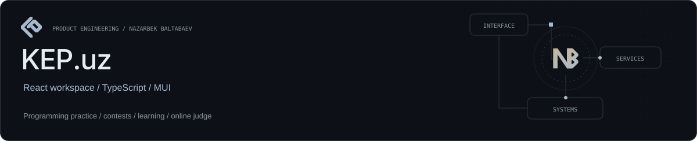

**The web experience for a programming community.**

[Live platform](https://kep.uz/) · [Local setup](#local-setup) · [Project structure](#project-structure) · [Quality gates](#quality-gates)

KEP.uz connects problem solving, contests, structured learning and community. This repository is its production React client, built around typed API contracts, reusable product modules and authenticated real-time experiences.

| Registered users | Visible problems | Contests | Submissions |
| ---: | ---: | ---: | ---: |
| 9,564 | 2,101 | 374 | 436,057 |

[Public platform snapshot](https://kep.uz/api/landing-page-statistics), **26 October 2026**. Registered users and total submissions; these are not activity or acceptance metrics.

### Engineering at a glance

- **Product breadth:** problems, submissions, contests, learning, duels, arena and community.
- **Defined boundaries:** application bootstrap, product modules and shared infrastructure.
- **Typed integration:** generated API clients, cookie/CSRF authentication and real-time updates.
- **Delivery:** automated checks, immutable frontend artifacts and deployment health checks.

Founded and built by [Nazarbek Baltabaev](https://github.com/archon1999).

---

# KEP.uz Frontend

Production web client for [KEP.uz](https://kep.uz), an Uzbek competitive-programming and learning platform. The application covers problems and submissions, contests, courses, tests, projects, duels, arena, challenges, tournaments, hackathons, community content, profiles, and KEPcoin features.

## Stack

- React 19, TypeScript 5, and Vite 7
- Material UI 7 for the component system
- React Router 7 for routing
- TanStack Query and SWR for server state
- Axios with cookie-based authentication and CSRF protection
- Orval-generated API clients from the backend OpenAPI schema
- Native WebSocket client for authenticated real-time updates
- Nginx for the production container

## Requirements

- Node.js 22.12 or newer
- npm with the lockfile committed in this repository
- A running KEP backend for API and WebSocket features

## Local setup

```bash
cp .env.example .env.local
npm ci --legacy-peer-deps
npm run dev
```

The development server listens on `http://localhost:4200`.

### Environment variables

| Variable | Purpose | Local example |
| --- | --- | --- |
| `VITE_API_URL` | REST API base URL | `http://localhost:8000/api` |
| `VITE_WS_URL` | WebSocket base URL | `ws://localhost:8000/ws/` |
| `VITE_BASIC_AUTH_LOGIN` | Optional development-only proxy credential | empty |
| `VITE_BASIC_AUTH_PASSWORD` | Optional development-only proxy credential | empty |

Every `VITE_*` value is public at build time. Never place production passwords, tokens, or private keys in these variables. The production build explicitly removes the development basic-auth values.

## Project structure

```text
src/
  app/       application bootstrap, providers, layouts, and routes
  modules/   product domains and their UI/data-access code
  shared/    reusable API, components, hooks, services, and utilities
  assets/    application-specific static assets
```

Code under `src/shared/api/orval/generated` is generated. Change the backend schema or Orval configuration instead of editing generated files by hand.

## Quality gates

Run the same checks used by CI before merging:

```bash
npm run lint
npm run typecheck
npm run test:unit
npm audit --audit-level=high
npm run build
```

To preview a production build locally:

```bash
npm run preview
```

## API client generation

`npm run orval:gen-api` regenerates the typed API client from the configured OpenAPI endpoint. Review generated changes together with the backend API change and rerun lint, typecheck, tests, and build afterward.

## Authentication and real-time behavior

- REST requests use secure cookies; unsafe methods obtain and send a CSRF token.
- WebSockets use the same-origin production endpoint unless `VITE_WS_URL` is provided for local development.
- Anonymous sessions do not open authenticated real-time connections.
- Server-provided rich HTML is sanitized before rendering.

## Delivery

Pushes to `production` run lint, typecheck, unit tests, dependency audit, and a production build in GitHub Actions. A successful build is uploaded as an immutable artifact, copied to the server, packaged in the Nginx image, health-checked, and rolled back automatically if deployment fails.

Production configuration should be copied from `.env.production.example`; only public endpoint values belong in that file.

